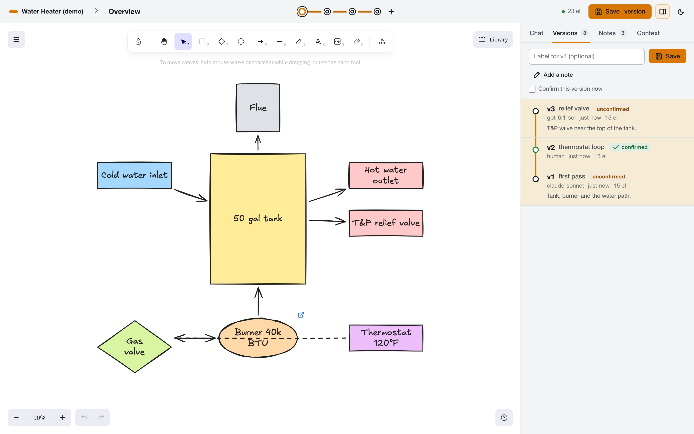
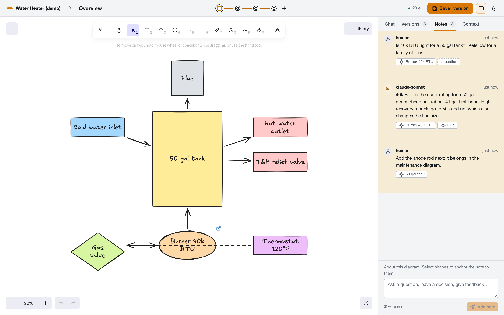
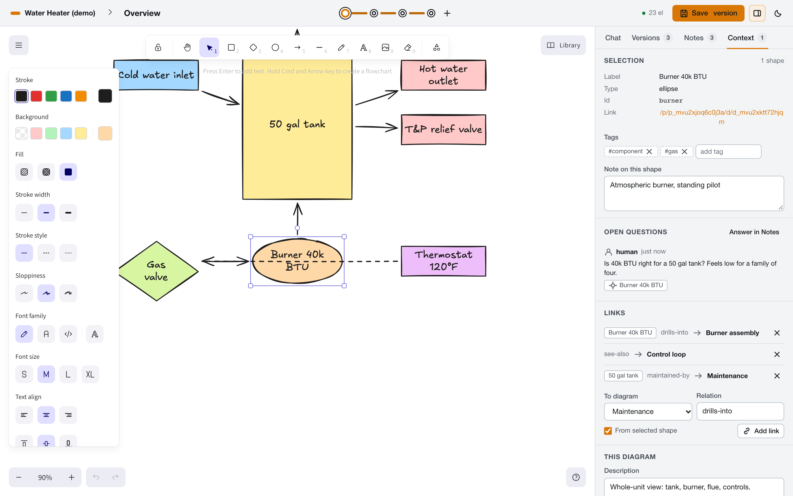
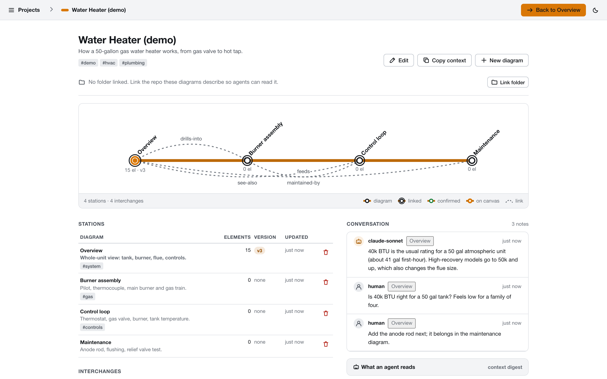
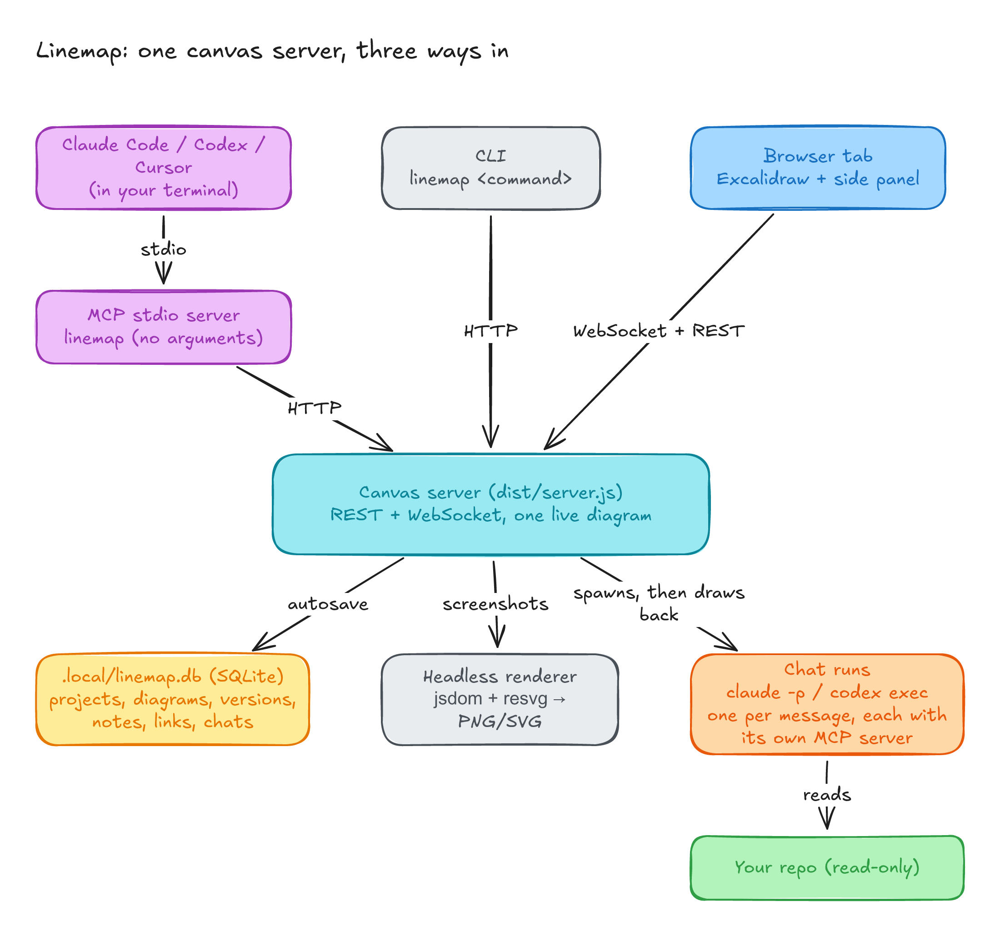

# Linemap

A local Excalidraw canvas that you and your coding agents share. You draw and annotate in the browser. Claude Code, Codex or any MCP client draws on the same canvas from your terminal, or from a chat panel inside the page. Workspace data is saved locally in SQLite, outside git, so a project's diagrams, versions and conversation are still there next week.


The screenshot is a real session. Claude Code (Sonnet) read two source files from this repo and drew how a chat message travels through the system. Codex then joined the same chat, searched the code read-only, and pinned a note to one of the boxes. Neither can edit the code they read.

## Quick start

You need [Bun](https://bun.sh) 1.3 or newer.

```bash
bun install
bun run build
bun dist/bin.js up --open
```

`up` runs the canvas server in your terminal with its log and opens the browser on `http://127.0.0.1:3000`. Ctrl-C stops it. The first run creates a Scratchpad project with one empty diagram. The page opens straight onto it.

Data stays in `.local/linemap.db`, which git ignores along with its sidecar files,
run logs, and exports. On the first start, Linemap imports the previous `data/`
JSON workspace in one transaction and leaves those files intact for recovery.
Stop any older running server before switching. Set `EXCALIDRAW_DATA_DIR` to
choose another storage directory. Node users need 22.13 or newer.

Other ways to run it are in [docs/reference.md](docs/reference.md#running-the-server): quiet or verbose logs, another port, in the background.

## What you get

A project holds everything about one subject you are working through, such as how a water heater works or how your order pipeline fans out. It contains diagrams, saved versions, a conversation pinned to shapes, and links between diagrams. One diagram is on the canvas at a time, and every open tab follows it.



Versions are saves you make on purpose: numbered, kept until you delete them, and confirmed once a human has checked them. The canvas also autosaves in the background, so a version is a checkpoint you chose, not your only copy.



Notes are the conversation. Select shapes, write a question, and the note is pinned to them. Agents read open notes before they draw and answer in the same thread.



The Context tab shows what the selected shape means: its tags, a note on the shape itself, open questions, and links. Tags and shape notes live inside the Excalidraw element (`customData`), so they travel with an exported `.excalidraw` file.



The project page draws the whole project as a transit line. Each diagram is a station, links are dashed interchanges, and a double ring marks a linked diagram. Clicking a shape that links to another diagram takes you there.

## Three ways in



- **From the browser.** Draw, save versions, leave notes, and chat with Claude Code or Codex in the Chat tab.
- **From an MCP client.** Claude Code, Codex, Cursor or Claude Desktop connect to `bun dist/bin.js` over stdio and get 52 tools: 26 for drawing, 26 for projects, diagrams, versions, notes, tags and links.
- **From the CLI.** The same operations as shell commands with JSON output, for scripts and quick edits.

All three talk to one canvas server, which keeps the live diagram in memory and persists the workspace in `.local/linemap.db`. [docs/how-it-works.md](docs/how-it-works.md) covers the processes, the data layout and the safety rules.

## Connect your agent

This repo has an `.mcp.json`, so Claude Code opened here already has the `excalidraw` server. Anywhere else:

```bash
claude mcp add excalidraw --scope user -- bun /absolute/path/to/linemap/dist/bin.js
```

For Codex, Cursor and Claude Desktop, use the same command in their MCP settings; `claude_desktop_config.example.json` has the shape. The MCP server starts the canvas on its own if nothing is listening.

An agent that has not seen a project yet should call `get_project_context` first. It returns one markdown summary of the project: its diagrams and versions, element tags, open notes, links, and the linked folder. The agent skill in `skills/excalidraw-skill` describes the full workflow; Claude Code in this repo loads it automatically.

## Chat with Claude Code or Codex in the page

The Chat tab runs the `claude` or `codex` CLI already installed and signed in on your machine. Each message starts one run. The run gets this project's MCP tools, reads the folder the project is linked to, draws while you watch, and resumes the same session on your next message. You can switch between the two mid-chat, and the newcomer gets the conversation so far.


[docs/chat.md](docs/chat.md) covers models and effort, speed, what the agents can and cannot touch, and where to find each run's log.

## Docs

- [How it works](docs/how-it-works.md): processes, data on disk, autosave and versions, rendering, security.
- [Chat with agents](docs/chat.md): the Chat tab, linking a folder, models, permissions, logs.
- [Reference](docs/reference.md): CLI commands, MCP tools, REST routes, environment variables.
- [Development](docs/development.md): building with Bun, tests, regenerating these screenshots.

## Credits

Built on [yctimlin/mcp_excalidraw](https://github.com/yctimlin/mcp_excalidraw) (MIT), which provides the drawing tools, headless rendering, Obsidian export, Mermaid conversion and the MCP transport. This repo adds the workspace, the agent chat and the browser UI. MIT licensed; font licenses are in `assets/fonts/LICENSES.md`.
