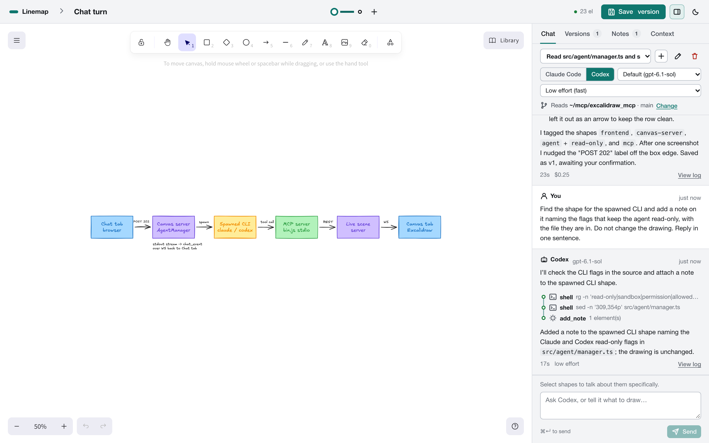
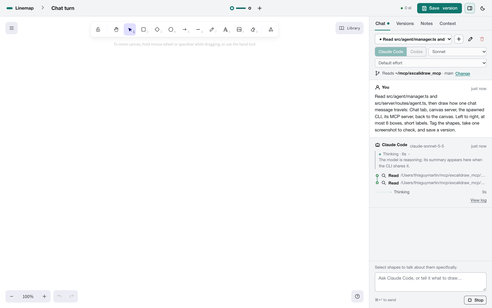
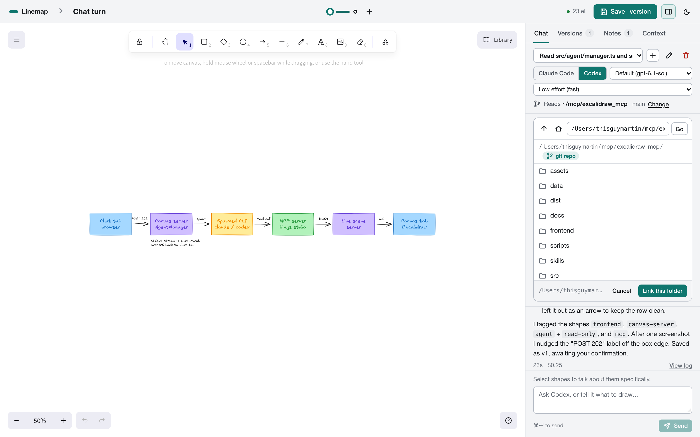

# Chat with Claude Code or Codex

The Chat tab lets you talk to the coding agent you already use, from inside the page. It runs the `claude` or `codex` CLI installed on your machine, signed in with your account, so there is no API key to set up. Each message costs what that CLI normally costs you.



## What happens when you send a message

1. The canvas server starts the CLI you picked, in the project's linked folder (or the project's data folder when none is linked).
2. It hands the CLI an MCP server pointed at this canvas, plus the context for the turn: the project summary on the first turn of a session, then on every turn the diagram you are looking at, the shapes you have selected, and the folder path.
3. The CLI reads files, draws, takes screenshots, tags shapes and leaves notes. Every change shows up on your canvas as it happens.
4. Its output streams into the tab. When it finishes, the server saves the session id, so your next message resumes the same conversation.



While a run is going, the status line says what the agent is doing ("Thinking", "Writing batch_create_elements · 3.2 kB", "Running get_canvas_screenshot") and how long it has taken. Tool calls appear as steps as they finish, and the reply text streams in. A Thinking block shows the agent's reasoning when the CLI shares it: Codex sends reasoning summaries, Claude Code only at higher effort levels. Stop ends the run.

## Chats and sessions

Each chat is a separate session. The dropdown at the top of the tab lists the project's chats, newest first; + starts a fresh one, the pencil renames it, and the bin deletes it with its run logs. A new chat starts clean; follow-ups in an existing chat resume where it left off.

You can switch between Claude Code and Codex in the middle of a chat. The agent that has not seen the conversation yet receives the earlier messages, then keeps its own session for later turns. In the screenshot above, Codex picked up a chat Claude Code had started and knew which diagram and shapes it was talking about.

One agent runs per project at a time, because both would be drawing on the same canvas.

## Models and effort

| Agent | Models | Effort |
|-------|--------|--------|
| Claude Code | Default (your CLI's setting), Sonnet, Haiku, Opus, or any model id | low, medium, high, xhigh, max |
| Codex | Default (read from `~/.codex/config.toml`), or any model id | low, medium, high |

Your choices are remembered per agent in this browser. Lower effort answers faster. Measured on this machine:

| Run | Time | Cost |
|-----|------|------|
| Haiku, low effort, two boxes and a screenshot | 8 s | under $0.01 |
| Sonnet, low effort, four boxes | 8 s | $0.11 |
| Sonnet, default effort, read two files and draw 6 boxes | 24 s | $0.25 |
| Codex (gpt-6.1-sol), low effort, find a shape and add a note | 17 s | not reported |
| Opus, default effort, a larger diagram | 107 s | not recorded |

Sonnet or Haiku at low effort is enough for drawing. Use a larger model or more effort when the agent has to reason over your code.

Codex starts about 3 seconds faster here because chat runs switch off the MCP servers in your own Codex config. They are not needed for drawing, and some wait on authentication at startup. Your model setting and sign-in are unchanged.

## Linking a folder



Link folder (in the Chat tab or on the project page) opens a browser of the folders on this machine, with git repositories marked. Pick the repo the project describes. From then on:

- each chat run starts in that folder and can read it;
- the project context lists the folder, its git branch and remote, and its top-level files;
- the project page shows the folder with a Reveal button that opens it in Finder.

From the terminal: `bun dist/bin.js project link <project> ~/code/repo`. From an agent: `link_project_folder`.

## What the agents can touch

| | Claude Code | Codex |
|-|-------------|-------|
| Canvas and workspace | every excalidraw MCP tool | every excalidraw MCP tool, pre-approved |
| Your linked folder | read only: `Read`, `Grep`, `Glob` | read only: the read-only sandbox |
| Shell commands | refused | read-only commands inside the sandbox |
| Editing files | refused | refused by the sandbox |
| Your other MCP servers | not loaded (`--strict-mcp-config`) | switched off for the run |

Claude Code runs with `--permission-mode dontAsk`, so anything outside that list is refused without prompting. Files an agent exports go to the project's data folder. Runs stop after 15 minutes (`EXCALIDRAW_AGENT_TIMEOUT_MS`).

The Chat tab and the folder browser only work when the canvas server listens on 127.0.0.1.

## Logs

Every reply has View log, which shows that run's raw CLI output: the arguments and prompt it was started with, every event, anything on stderr, and the exit code. The files are in `.local/projects/<project>/runs/` (or under `EXCALIDRAW_DATA_DIR`).

The server log records one line when a run starts and one when it finishes or fails:

```bash
bun dist/bin.js logs -f --agent
```

## When something is wrong

- **The agent picker is greyed out.** That CLI was not found. The server looks on your PATH and in the usual install folders; set `EXCALIDRAW_CLAUDE_BIN` or `EXCALIDRAW_CODEX_BIN` to its full path, then press check again.
- **A run fails straight away.** Open View log. The last lines usually say why: not signed in, an unknown model id, or a quota.
- **Nothing seems to happen for a while.** Check the status line. Large models at high effort can think for a minute before they start drawing.
- **"An agent is already working in this project."** Wait for it, or press Stop.
