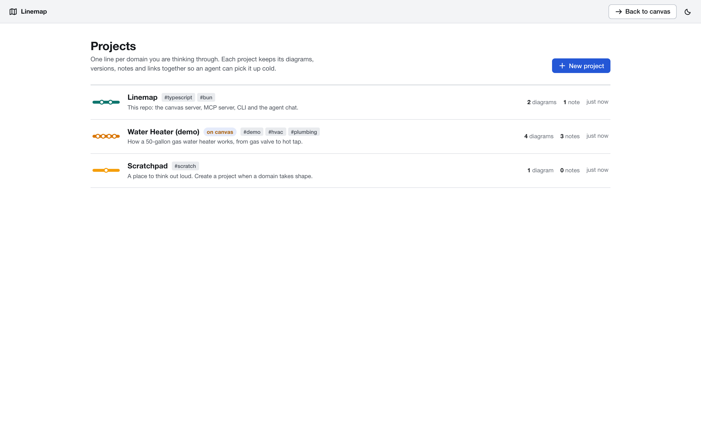
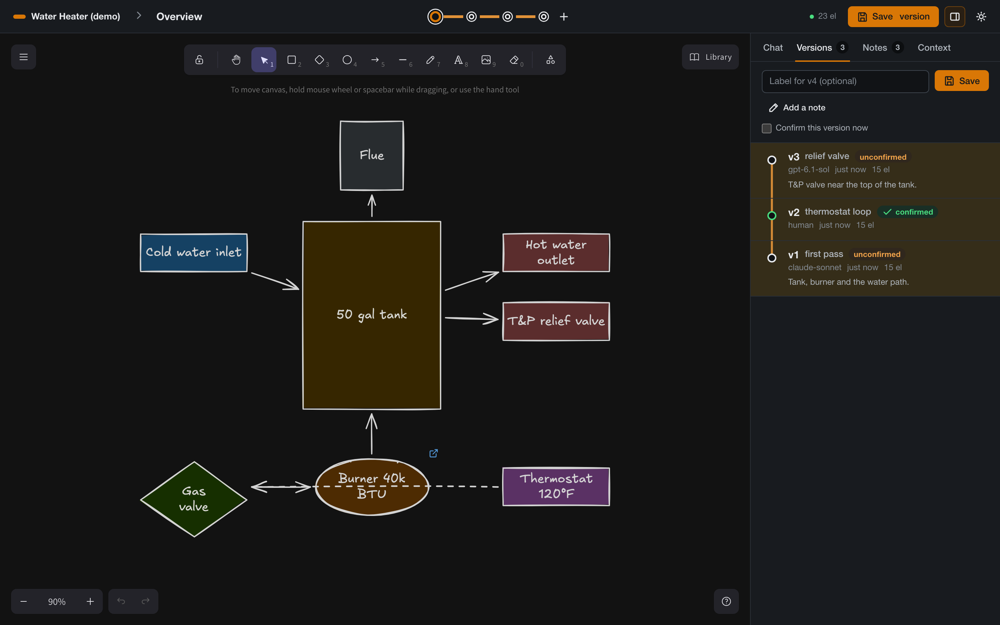

# Reference

## Running the server

| Command | What it does |
|---------|--------------|
| `bun dist/bin.js up --open` | Runs the canvas server in this terminal with its log, and opens the browser |
| `bun dist/bin.js up --quiet` | The same, showing errors only |
| `bun dist/bin.js up --verbose` | The same, showing everything |
| `bun dist/bin.js up --port 3100` | Uses another port (or set `EXPRESS_SERVER_URL`) |
| `bun dist/bin.js up --node` | Runs the server on Node instead of Bun |
| `bun dist/bin.js start` | Starts the server in the background |
| `bun dist/bin.js stop` | Stops the background server |
| `bun dist/bin.js status` | Shows whether it is running, element count and open tabs |
| `bun dist/bin.js logs -f` | Follows the server log |

Ctrl-C stops `up`. If a server is already running on the port, `up` attaches to its log instead of starting a second one. Use `--url http://127.0.0.1:3100` with `start`, `stop` and `status` for a port other than 3000.

`bun serve`, `bun serve:quiet` and `bun logs` are shortcuts in `package.json`. Run `bun link` once in the repo to get a `linemap` command you can use from any folder.

The browser app lives at `/`, which opens the diagram currently on the canvas. `/p/<project>` is a project's map and `/projects` lists every project.

## CLI

`bun dist/bin.js <command>`. Results are JSON on stdout, except `describe`, `context` and `logs`, which print text. Exit codes: 0 ok, 1 error, 2 usage, 3 canvas unreachable, 4 needs a browser tab. `bun dist/bin.js help <command>` prints usage for one command.

Workspace:

| Command | Use |
|---------|-----|
| `project list \| create \| show \| update \| link \| unlink \| delete` | Projects. `create <name> --folder <path> --tags a,b`, `link [project] <folder>`, `delete <project> --yes` |
| `diagram list \| create \| open \| show \| active \| update \| delete` | Diagrams. `create` opens the new diagram unless you pass `--no-open` |
| `version list \| save \| confirm \| restore \| show \| delete` | Numbered versions. `save "label" --note "why" --confirm`, `restore 3 --save-current "before restore"` |
| `note list \| add \| resolve \| reopen \| delete` | Notes. `add "text" --elements a,b --tags question` |
| `link list \| add \| delete` | Links. `add --to "Burner assembly" --from-element burner --relation drills-into` |
| `tag set \| add \| remove \| find` | Element tags. `add --ids a,b --add gas`, `find gas` |
| `context` | Prints the project summary an agent reads |

Drawing, acting on the diagram on the canvas:

| Command | Use |
|---------|-----|
| `add`, `apply` | Create elements from JSON, or apply a `{create, update, delete}` patch |
| `get`, `query`, `update`, `delete` | Read and change single elements |
| `describe` | Text description of the scene: ids, positions, labels, tags, connections |
| `screenshot` | PNG or SVG of the canvas, rendered without a browser |
| `render <file>` | Renders a `.excalidraw` file offline, with no server |
| `export`, `import` | `.excalidraw` JSON, or Obsidian `.excalidraw.md` when the path ends in `.md` |
| `mermaid` | Converts Mermaid text onto the canvas (needs a browser tab) |
| `arrange` | Align, distribute, group, lock, duplicate |
| `snapshot save \| list \| restore` | In-memory undo points, lost on restart |
| `share` | Uploads an encrypted copy to excalidraw.com and prints the link |
| `clear --yes` | Removes every element from the diagram |
| `install-skill` | Copies the agent skill to `~/.claude/skills` or another folder |

## MCP tools

Projects, diagrams and their history (26):

| Area | Tools |
|------|-------|
| Projects | `list_projects`, `create_project`, `get_project`, `update_project`, `delete_project`, `get_project_context`, `link_project_folder` |
| Diagrams | `list_diagrams`, `create_diagram`, `open_diagram`, `get_active_diagram`, `update_diagram`, `delete_diagram` |
| Versions | `save_version`, `list_versions`, `confirm_version`, `restore_version`, `delete_version` |
| Notes | `add_note`, `list_notes`, `resolve_note` |
| Tags | `tag_elements`, `find_by_tag` |
| Links | `link_diagrams`, `list_links`, `delete_link` |

Projects can be named by id, slug or name; diagrams by id or name; versions by id, number or `v3`. `delete_project` and `delete_diagram` need `confirm: true`.

Drawing (26), always acting on the diagram on the canvas: `create_element`, `batch_create_elements`, `update_element`, `delete_element`, `get_element`, `query_elements`, `duplicate_elements`, `group_elements`, `ungroup_elements`, `align_elements`, `distribute_elements`, `lock_elements`, `unlock_elements`, `describe_scene`, `get_canvas_screenshot`, `get_resource`, `read_diagram_guide`, `export_scene`, `import_scene`, `export_to_image`, `export_to_excalidraw_url`, `create_from_mermaid`, `snapshot_scene`, `restore_snapshot`, `clear_canvas`, `set_viewport`.

Shapes take a `text` label, arrows bind with `startElementId` and `endElementId`, and `fontFamily` accepts names such as `"helvetica"`. Parameter details are in `skills/excalidraw-skill/references/cheatsheet.md`.

## REST API

Everything the browser, the CLI and the MCP server do is plain HTTP on the canvas server. Raw REST is stricter than the CLI and MCP tools: a shape label is `"label": {"text": "…"}` and an arrow binds with `"start": {"id": "…"}` and `"end": {"id": "…"}`.

| Area | Routes |
|------|--------|
| Elements | `GET/POST /api/elements`, `GET/PUT/DELETE /api/elements/:id`, `POST /api/elements/batch`, `DELETE /api/elements/clear`, `GET /api/elements/search`, `POST /api/elements/sync`, `POST /api/elements/from-mermaid` |
| Files and images | `GET/POST /api/files`, `POST /api/export/image`, `POST /api/viewport`, `GET/POST /api/snapshots` |
| Workspace | `GET /api/workspace`, `GET/POST /api/projects`, `GET/PATCH/DELETE /api/projects/:id`, `GET /api/projects/:id/context` |
| Diagrams | `GET/POST /api/projects/:id/diagrams`, `GET/PATCH/DELETE /api/diagrams/:id`, `POST /api/diagrams/:id/open`, `PUT /api/diagrams/:id/scene` |
| Versions | `GET/POST /api/diagrams/:id/versions`, `GET/PATCH/DELETE /api/versions/:id`, `POST /api/versions/:id/restore` |
| Notes, links, tags | `GET/POST /api/projects/:id/notes`, `PATCH/DELETE /api/notes/:id`, `GET/POST /api/projects/:id/links`, `DELETE /api/links/:id`, `POST /api/elements/tags`, `GET /api/tags/:tag` |
| Chat | `GET /api/agents`, `GET/POST /api/projects/:id/chats`, `GET/PATCH/DELETE /api/projects/:id/chats/:chat`, `POST /api/projects/:id/chats/:chat/messages` (`:chat` can be `new`), `GET …/messages/:message/log`, `POST /api/projects/:id/chat/cancel` |
| Folders | `GET /api/fs/dirs?path=`, `GET /api/projects/:id/folder`, `POST /api/projects/:id/reveal` |
| Health | `GET /health`, `GET /api/sync/status` |

WebSocket clients receive element changes plus `workspace_event` messages (`active_changed`, `diagram_saved`, `version_changed`, `note_changed`, `project_changed`, `diagram_changed`, `link_changed`) and `chat_event` messages while agents run.

## Environment variables

| Variable | Default | Meaning |
|----------|---------|---------|
| `PORT`, `HOST` | `3000`, `127.0.0.1` | Where the canvas server listens |
| `EXPRESS_SERVER_URL` | `http://127.0.0.1:3000` | Where the MCP server and the CLI find the canvas |
| `EXCALIDRAW_DATA_DIR` | `<repo>/.local` | Directory containing `linemap.db`, run logs and exports; existing JSON here is imported once |
| `EXCALIDRAW_NO_AUTOSTART` | unset | `1` stops the MCP server and CLI from starting the canvas |
| `EXCALIDRAW_EXPORT_DIR` | current folder | Folder that file exports may write to |
| `EXCALIDRAW_CLAUDE_BIN`, `EXCALIDRAW_CODEX_BIN` | found automatically | Agent CLIs for the Chat tab |
| `EXCALIDRAW_AGENT_TIMEOUT_MS` | `900000` (15 min) | How long a chat run may take |
| `LOG_LEVEL` | `info` | Level written to the log file |
| `LOG_FILE_PATH` | `~/Library/Logs/linemap.log` on macOS | Log file |

## Night theme

The theme follows Excalidraw's own toggle (or the moon button in the top bar) and is remembered per browser.
